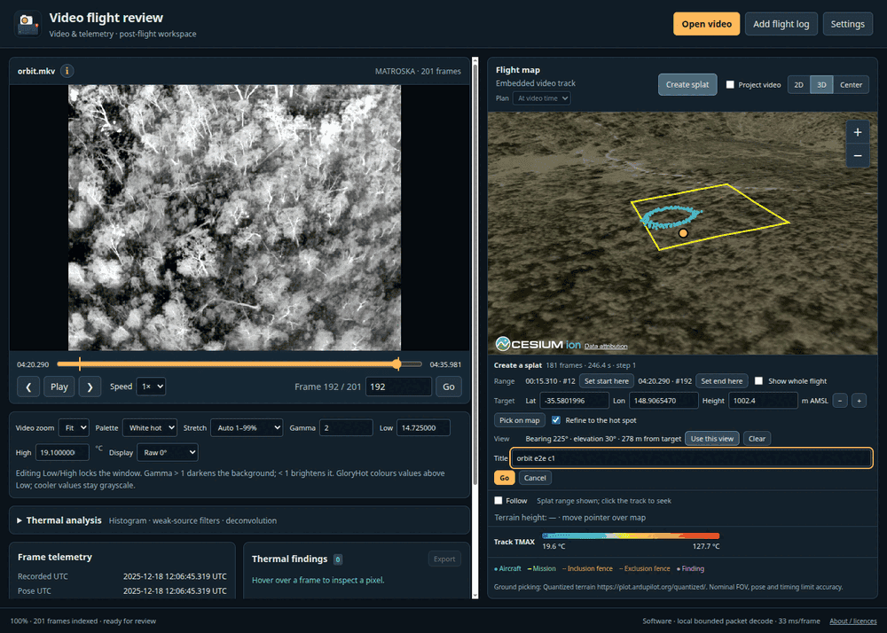
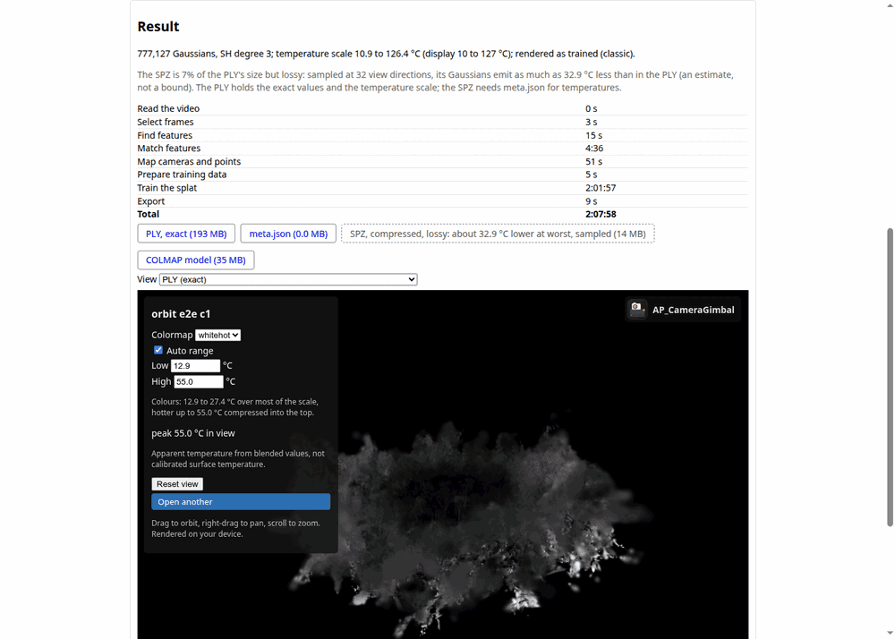
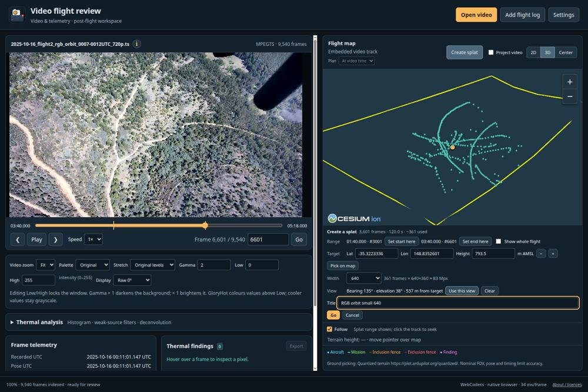
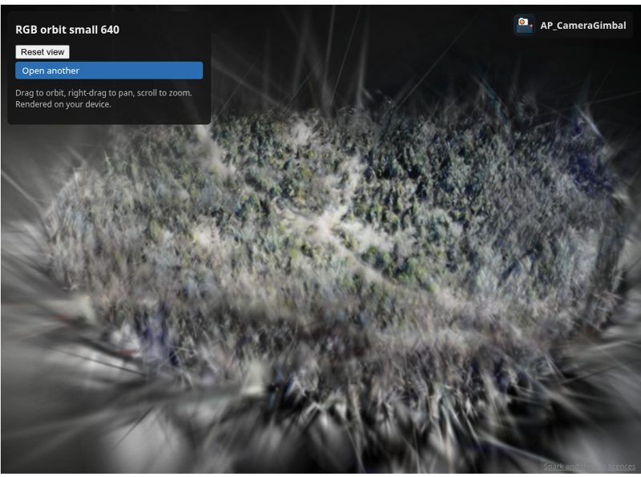
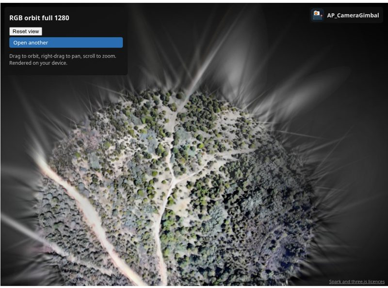
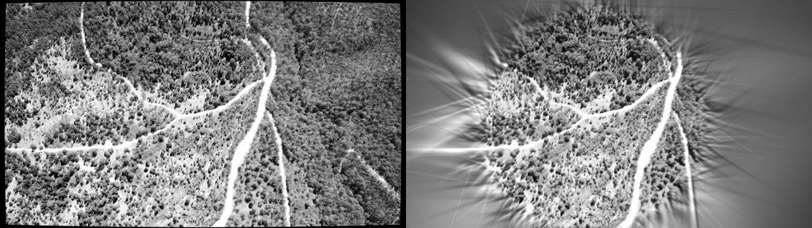

# v2: splats from the video viewer

PLAN-v2.md: the video viewer's Create splat panel picks a time range, a target and an export
view, then hands the recording and a `websplat.request` to WebSplat, which runs the job from it.
Both cases below drive the built viewer (`/video/`) and WebSplat (`/websplat/`) served from one
origin, in a headless Chrome on the laptop's Intel iGPU (fresh profile per case), from the
2025-10-16 orbit thermal MKV (201 frames).

## Thermal

### Case 1: frames 12-192 (index 11-191), refine on

- Target picked on the hot spot in the viewer's 3D map: 0.41 m from the reference hot spot.
- The map's track showed only the chosen range; the request matched the panel (lat/lon to 7 dp,
  heights to 2 dp, as the request rounds them); job `thermal-<source>-<request key>`; the page
  URL became `?job=`; the viewer saw `websplat.accepted` 0.38 s after Go.
- Select took 180 of 181 frames; no confirmation form was shown.
- Export's start camera equals the view captured in the viewer (computed from `frames.origin`).
- 777,127 Gaussians.

| Stage | Time |
|---|---|
| Read the video | 0 s |
| Select frames | 3 s |
| Find features | 15 s |
| Match features | 4:36 |
| Map cameras and points | 51 s |
| Prepare training data | 5 s |
| Train the splat | 2:01:57 |
| Export | 9 s |
| **Total** | **2:07:58** |

Training shared the iGPU with other work for part of the run.

### Case 2: frames 61-141 (index 60-140), refine off

The first attempt selected only 19 of 81 frames. With refine off the target is where the user
clicked, and the telemetry poses are biased: the hot spot refine found in case 1 is 34 m from the
true location the user picks. Projected through the telemetry poses, the picked target fell near
or past the image edge in most frames, outside select's default 10% margin. A request with
refine off now selects with `margin` -0.25, so the target may project up to a quarter frame
outside the image. The rerun selected 61 of 81.

- Pick 0.43 m from the reference hot spot; request, job id and `?job=` URL checks as case 1.
- `config.export.target` is `picked`: meta.json's target is `frames.target_enu` (the pick at
  the request's height), and the start camera equals the captured view.
- 718,442 Gaussians; 20 of 20 checks passed.

| Stage | Time |
|---|---|
| Read the video | 0 s |
| Select frames | 1 s |
| Find features | 5 s |
| Match features | 46 s |
| Map cameras and points | 5 s |
| Prepare training data | 2 s |
| Train the splat | 4:22:19 |
| Export | 9 s |
| **Total** | **4:23:28** |

Training ran alongside the RGB runs below on the same iGPU for most of its time, so its time is
not representative.

### Observations

- With refine on, `target_alt` (from the picked height) replaces the hot spot's height, so refine
  moves the target only horizontally.
- A job's `config.select` is fixed when the job is created: a job made before the margin change
  keeps its old selection when reopened with the same request.

## RGB

Two RGB recordings of the 2025-10-16 orbit (the same flight, recorded by the camera at once):
a 1280x720 H.264 MPEG-TS with MISB KLV (no relative altitude) and the 2560x1440 HEVC MPEG-TS
with APCG SEI telemetry. Each was opened in the built viewer (`test/v2/rgb-e2e.mjs`), Create
splat set to frames #3001-#6601 (120.0 s, 3601 frames: two laps of the orbit, about 545 m above
the ground), the default target (median of the look points on the shared terrain:
-35.3223336, 148.8352601, 793.5 m AMSL), a width, and Go. The jobs ran to the result view with
default settings (30000 iterations), on the laptop's Intel iGPU.

| | 720p H.264 + KLV, width 640 | 2560 HEVC + SEI, width 1280 |
|---|---|---|
| job | `rgb-9546301385cdc6cb-43109b33709ffdf3` | `rgb-09dcbf014bc1ab7c-c21fc03f35ccb365` |
| URL after the handover | `/websplat/?job=<job>` | `/websplat/?job=<job>` |
| takeoff altitude | 1473.1 m (first KLV record: the recording starts airborne) | 584.7 m (median of SEI alt_amsl - alt_relative) |
| frames sampled at 3 fps / out of view / selected | 350 / 8 / 342 | 350 / 8 / 342 |
| decoder (decode time) | WebCodecs (18.4 s) | FFmpeg, no HEVC in Linux Chrome's WebCodecs (34.7 s) |
| registered | 342 of 342 (100%) | 342 of 342 (100%) |
| points, mean reprojection | 68,125, 0.53 px | 94,977, 0.79 px |
| focal (seeded from the KLV/SEI HFOV of 58.1 degrees) | 468.4 px (577 seeded: about 69 degrees) | 931.8 px (1154 seeded) |
| mapper heap | 4.15 GB (12.8M matches, thinned) | 2.86 GB |
| training images (held out), initial points | 342 (14), 18,003 | 342 (14), 27,439 |
| Gaussians (cap 1M on an integrated GPU) | 615,487 | 994,084 |
| PLY / SPZ | 64.0 MB / 12.6 MB | 103.4 MB / 20.5 MB |
| start view | captured in the viewer (bearing 135 degrees, elevation 38 degrees, 537 m) | none: the middle training view |

Stage times (s):

| | ingest | select | features | match | map | prepare | train | export |
|---|---|---|---|---|---|---|---|---|
| 640 | 5.2 | 24.0 | 19.2 | 216 | 1014 | 3.7 | 10,463 (2.9 h) | 6.0 |
| 1280 | 6.9 | 41.5 | 110 | 288 | 879 | 13.9 | 13,910 (3.9 h) | 4.7 |

Overlap: the thermal e2e case was training on the same iGPU during the 640 run's match, map and
the first part of its training; the 1280 run's ingest to prepare (and 5% of a first training
attempt, stopped and later restarted from the start) ran during the 640 run's training. The
thermal e2e finished while the 1280 job was training (when exactly is not recorded). Training
times are therefore upper bounds; the 1280 job's earlier stages also overlapped training.

- **Start views.** The 640 result opens from the captured view: `meta.json` camera at
  (300, -301, +330) m from the target, the offset set in the viewer. The 1280 result has no
  captured view and opens from the middle training view (`export_web.start_camera`).
- **Georeferencing.** The two jobs use different vertical datums (takeoff 1473.1 m vs 584.7 m)
  but the same target: the sparse points within 25 m of it are at 812.9 m and 814.7 m AMSL, 1.8 m
  apart; SRTM there is 793.5 m, and the 20 m difference is the forest canopy. Camera centres moved
  from their telemetry by a median of 18.6 m (at most 51 m) in both jobs, with no systematic
  shift (mean offset under 1.1 m; along track median -2 m, i.e. 0.08 s at 25.7 m/s, but 14 m
  median magnitude): per-frame scatter, the same with KLV and SEI. The thermal MKV of this
  flight, ingested over the same 120 s, has the takeoff altitude of the SEI recording (584.735 m),
  so a thermal job with this target uses the same ENU frame as the 1280 job; its own proposal
  (where the optical axes converge, as the 377 hot frames give no consistent hot spot) is 17 m
  east of the RGB target, with a poorly constrained height (872 m, 188 px ray error). The
  thermal e2e cases above used another recording, so there is no splat-to-splat comparison.
- **Quality.** The 1280 splat is sharp and in true colour within about 200 m of the model centre
  (`train_rgb.py`'s fixed `--radius`). At 545 m above the ground each frame covers about 700 m,
  so the pruned area beyond the radius is filled by a few large Gaussians that show as streaks
  in held-out views (640, held-out view, red channel: 16.6 dB against 12.2 dB for a flat image;
  the centre matches, the edges do not):
  
  A radius scaled to the frame footprint would suit high orbits better. The 720p H.264 source is
  visibly less saturated than the HEVC original, which shows in the 640 splat.
- **SPZ.** 23% of the 640 splat's colour coefficients are beyond SPZ's range and clamped (bright
  ground seen through semi-transparent Gaussians); the PLY is exact and is what the result view
  opens.

Fixes from these runs:

- The 640 job first failed in mapping with `std::bad_alloc` (342 images, 12.8M verified
  matches: the 4 GB WebAssembly heap). RGB jobs now use 4096 SIFT features (`config.features`)
  and a 500-frame budget, and above 6M matches the mapper keeps a consistent subset of each
  image's keypoints (`thinMatches`; the stage result records `matches` and `keptKeypoints`);
  running out anyway fails with a message naming the images and matches. The runs above used an
  8M threshold; it is now 6M, as 8M took the heap to 4.15 GB.
- The export then failed its SPZ check on 25 of 1.8M colour values just outside the allowance:
  Spark stages both the coefficient and the colour as float16, and the check now allows both.

